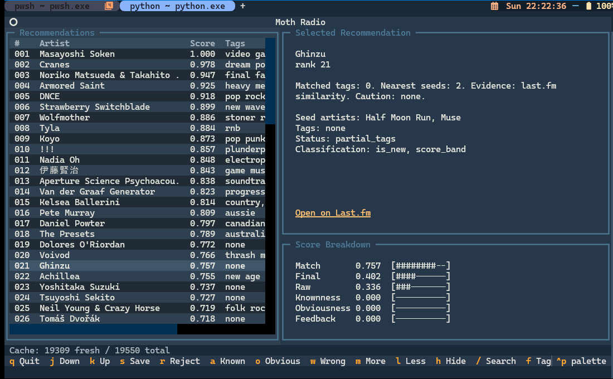

# Moth Radio

## What this is

Moth Radio is a single-listener artist recommendation workbench. It is for getting better recommendations from your own listening history without friends, follows, shared playlists, public profiles, or other social-platform features.

It imports a Last.fm CSV export into DuckDB, builds long-term and recent taste regions, and optionally enriches the local catalog with cache-first Last.fm, MusicBrainz, and ListenBrainz data. Recommendation runs consume persisted local evidence rather than live APIs. Each run records its immutable query context, evidence snapshot, admission decisions, feature values, ranking scores, and slate-policy effects so results can be inspected, exported, replayed, and compared.

The current CLI produces general discovery, artist-conditioned continuation, and rediscovery lists. Its source-aware pipeline is designed to accept additional persisted evidence without comparing unrelated providers' raw scores. Acquisition may use the network when you explicitly run enrichment; recommendation generation, evaluation, export, and TUI browsing use local data.

The Python package and command-line tool are named `scrobble-recs`. Your listening history, recommendation runs, feedback, evidence, and API cache stay on your machine.

**AI Disclosure:** This is a purpose-built tool for my own uses, designed by me and written entirely by AI. DeepSeek and Codex were used in the development of this tool.

## Blinded local recommendation experiments

Compare two distinct persisted runs with matching query kind, target, semantic history/feedback
context and nonempty evidence snapshot. Scorer settings and versions may differ. Historical runs
without recorded provenance remain browsable but cannot establish a compatible experiment.

```bash
scrobble-recs experiment-create --config ./config.json --control-run-id CONTROL_UUID --challenger-run-id CHALLENGER_UUID --seed 7
scrobble-recs experiment-next --config ./config.json --experiment-id EXPERIMENT_UUID --slate-size 10
scrobble-recs experiment-judge --config ./config.json --exposure-id EXPOSURE_UUID --label 123:want_to_try --note "Try later"
scrobble-recs experiment-next --config ./config.json --experiment-id EXPERIMENT_UUID
scrobble-recs experiment-judge --config ./config.json --exposure-id EXPOSURE_UUID --list-choice left --best-discovery-artist-id 123 --label 123:strong_fit --confidence 0.8
scrobble-recs experiment-report --config ./config.json --experiment-id EXPERIMENT_UUID --outcome-cutoff 2030-01-01T00:00:00Z
```

Commands emit JSON; `experiment-next` emits `null` when exhausted. Replace the placeholder UUIDs and
artist ID with IDs from your local runs and shown items. Slates and names freeze at creation, before
later feedback can change a source run. The seed fixes hidden side assignment. Duplicates appear once
across the experiment while preserving private source memberships. `--slate-size` caps each side;
incomplete pages always reopen with their original order, regardless of a newly requested size.

The six labels are `want_to_try`, `strong_fit`, `surprising_good`, `already_known`, `wrong_direction`
and `reject`. Repeat `--label ARTIST_ID:LABEL` to label more items. **Each judgment replaces the whole
effective snapshot:** omitted fields and an omitted label mapping clear prior answers. Label-only,
preferred-side-only (`--preferred-side`) and best-discovery-only submissions are resumable partial
evidence. An explicit `--list-choice left|right|tie|none` completes a page; `none` is an abstention,
while omission means unanswered. Best discovery and preferred side are independent of list choice.
Confidence is optional and must lie in `[0,1]`. Judgments do not record ordinary feedback or rerank.

In the TUI, press `x` from a persisted run to open its experiments, then `x` to cycle them. Move with
arrow keys; `1`–`6` toggle the selected artist's labels, `b` toggles best discovery, `p` cycles preferred
side and `c` cycles list choice (unanswered, left, right, tie, none). Tab accesses optional confidence
and note fields. `s` saves the full partial/current state, `n` saves and advances after a list choice,
and Escape returns to the run browser. Saved fields restore when reopened. Source identity and
scoring details are hidden throughout judging; `experiment-report` intentionally reveals attribution.

Reports count current effective judgments once per exposure. Listening outcomes use only recorded
shown artists and nonduplicate scrobbles strictly after exposure and strictly before the UTC cutoff.
“Adoption” means any post-exposure listening, including previously known artists; “repeat” means two
or more plays. The earliest exposure owns listening credit for a repeated artist within an experiment.
Shared artists split labels, best discovery, listening, plays and artist-active-day units equally
between contributing variants; list choices follow the hidden side assignment. Reports expose
denominators, null rates for empty windows, and raw shared counts. Recomputing at earlier/later cutoffs
replaces local outcome rows. Different experiments are separate observations, not independent causal
discoveries to sum together.

Guardrail deltas use frozen persisted run facts: mean `1-knownness`, mean identity confidence,
primary-tag entropy and provider membership concentration where recorded facts support them.
Partial coverage is explicit; unavailable historical popularity or other facts remain null. These
experiments do not promote a scorer or enable fusion. New artist-query relationship snapshots count
recorded exposures before their cutoff; when none precede it, the explicit run-appearance fallback
remains. All experiment commands and TUI interactions operate locally without API calls.

## Algorithms

Moth Radio is a local, graph-based recommender. In essence, it works like this:

Listening history → seed artists → graph/tag candidates → eligibility gate → calibrated scoring → novelty penalties/bonuses → diversity rerank → persisted run

When a recommendation is generated, the inputs, eligibility decision, score components, and reranking evidence are also persisted so you can see the criteria behind the recommendation.

See the Appendix for a full overview of the recommendation algorithm.

## Quick start

### 0. Get your Last.fm History

You need a CSV export of your Last.fm scrobble history. Use a tool like [this one](https://lastfm.ghan.nl/export/) to obtain the file. 

### 1. Install

```bash
python -m venv .venv
source .venv/bin/activate
python -m pip install -e ".[dev]"
scrobble-recs --help
```

PowerShell activation:

```powershell
python -m venv .venv
.venv\Scripts\Activate.ps1
python -m pip install -e ".[dev]"
scrobble-recs --help
```

You can use `python -m scrobble_recs` instead if the installed `scrobble-recs` command is not on your `PATH`.

### 2. Create and configure a local project

```bash
scrobble-recs init --config ./config.json
```

`init` refuses to overwrite an existing file; add `--force` only when you intentionally want to replace it. Set `input.lastfm_csv` in `config.json` to your Last.fm CSV export. The generated file documents local paths, API settings, evidence thresholds, and recommendation settings.

You only need `LASTFM_API_KEY` for Last.fm enrichment. MusicBrainz does not require an API key, but you must set `apis.musicbrainz.enabled` to `true` before using its commands and should configure an identifying user agent.

### 3. Import your history

```bash
scrobble-recs import --config ./config.json
scrobble-recs doctor --config ./config.json
```

Import creates local normalized artists, tracks, scrobbles, and diagnostics. `doctor` checks the configuration, database, import quality, cache, and API-key state without requiring network access.

### 4. Enrich persisted evidence (optional, recommended)

Plan first if you want to see the amount of work without making network calls. Last.fm enrichment is cache-first and resumable; it persists similarity edges, artist tags, and tag top-artist data. `--depth 2` also enriches the hop-one frontier and can be bounded with `--max-frontier-artists`.

```bash
export LASTFM_API_KEY=your-key
scrobble-recs enrich-plan --config ./config.json --source lastfm
scrobble-recs enrich --config ./config.json --source lastfm
# Optional broader graph acquisition:
scrobble-recs enrich --config ./config.json --source lastfm --depth 2 --max-frontier-artists 250
```

PowerShell:

```powershell
$env:LASTFM_API_KEY = "your-key"
scrobble-recs enrich-plan --config ./config.json --source lastfm
scrobble-recs enrich --config ./config.json --source lastfm
```

After enabling MusicBrainz in `config.json`, resolve ambiguous local artist identities separately:

```bash
scrobble-recs resolve --config ./config.json --source musicbrainz
```

`enrich --source musicbrainz` resolves identities, then acquires bounded catalog facts and aliases. MBIDs remain evidence, not automatic proof that two artists are identical; ambiguous results stay separate.

### 5. Generate and inspect a run

```bash
scrobble-recs recommend --config ./config.json --limit 100
scrobble-recs export --config ./config.json --output recs.csv --format csv
scrobble-recs tui --config ./config.json
```

To explore an artist's neighborhood using the same persisted-data pipeline:

```bash
scrobble-recs recommend --config ./config.json --artist "The Cure" --limit 25
scrobble-recs recommend --config ./config.json --artist 42 --mode explore
```

`--artist` resolves an exact local MusicBrainz artist MBID first, then a positive numeric artist ID,
then a normalized exact canonical name. Ambiguous matches list IDs and names; missing matches fail
without constructing a network client. Aliases and fuzzy names are not lookup alternatives. The CLI
prints the target ID, canonical name, and relationship state from the persisted query context.

Artist retrieval first bounds the neighborhood to target-origin Last.fm edges and walks, shared
semantic facets, enabled target-origin ListenBrainz memberships, and explicitly enabled catalog
relationships. Personal taste and feedback rerank only that pool. Global chart placement or personal
positive feedback alone cannot introduce an unrelated artist. Sparse neighborhoods return fewer
results. Safe known neighbors are labeled `known`, unheard neighbors `new`. The default control uses the
existing scorer and its knownness, trial-listen, fatigue, and diversity policies; deeply known
neighbors receive the existing knownness preference reduction. Modes,
including `rediscovery`, remain available. Hides, cooldowns, explicit negative artist feedback, and
identities below the safety threshold remain excluded. Provider membership scores/ranks stay null.

The immutable `artist-relationship-v1` snapshot counts duplicate-free scrobbles in the requested
half-open history window, strictly before the as-of/history/feedback cutoff. It records counts,
unique nonempty track/release keys, UTC active days/months, first/last listen, span, feedback, and
prior persisted run appearances (`exposure_source=run_appearance`). Missing track keys count as
individual singleton replay groups and stay in the play denominator. Recency-weighted plays sum
the existing `exp(-days/400)` profile decay. Recent trend compares actual available recent
(up to 90 days) and earlier daily rates: both zero gives 0; recent evidence without an earlier
rate gives finite 1. Release keys are local album keys, not claims of resolved catalog identity.

Initial configurable `recommendation.artist_relationship` thresholds are `sampled_max_plays=5`,
`established_min_plays=20`, `established_min_active_months=3`, and `dormant_days=730`. Zero plays is
`unheard`; both established thresholds plus at least 730 inactive days is `dormant_favorite`;
both established thresholds otherwise is `established_favorite`; all other heard histories remain
conservatively `sampled`. The explicit low-depth sampled band is persisted separately. Short history
windows can therefore omit a dormant relationship; extend `--since` when that history is relevant.

The default `artist-control-v1` profile uses the selected existing deterministic scorer (`legacy`
or `walk`) and its configured component weights, mode multipliers, calibration, identity scaling,
serendipity, and slate policy over the explicit target pool. Walk retrieval uses the existing
`walk.max_hops` bound. Relationship state is recorded but does not silently activate new numerical
controls. Unranked radio/catalog membership alone receives no positive relevance prior; it can
remain a retrieved diagnostic candidate with zero relevance and no selected result. Finite semantic
or other existing scoring evidence can still support that neighbor. Invalid Last.fm similarity rows
are omitted consistently from scoring, features, and provenance; run diagnostics retain their IDs
and string-valued rejection reasons without serializing NaN/Infinity.

An experimental, reversible profile is available through
`recommendation.artist_challenger.enabled=true`, which is **false by default**. The validated,
versioned `artist-challenger-v1` configuration contains all additional tunables: target/personal/
existing relevance weights (initially 0.75/0.15/0.10, nonnegative and summing to one), structural
membership prior (0.25), hop-proximity scale (1.0, divided by `hop+1`), known-neighbor reduction
(0.12), and per-state radius/popularity/obviousness controls. Initial unheard/sampled/established/
dormant radii are 1/1/2/2, bounded by `walk.max_hops`; popularity preferences are +0.10/0/-0.10/-0.05
and obviousness weights are 0.05/0.10/0.20/0.15. These values are unvalidated challenger settings,
not production defaults. Use an explicitly configured file for local evaluation, for example:

```bash
scrobble-recs evaluate-rolling --config ./artist-challenger.json --task artist \
  --cutoff 2024-01-01 --horizon-days 90
```

Each run persists the active control/challenger profile, actual settings, existing scorer weights,
and target/personal/existing relevance contributions. Popularity, novelty, and other slate effects
remain outside relevance: candidate policy JSON records each signed adjustment in final-score units,
including diversity, clipping and exclusion, so `relevance + sum(policy components) = final score`.
Challenger popularity/obviousness effects honor `obviousness.enabled`, and its additional known-neighbor
reduction honors `knownness.enabled`. Disabling the challenger restores the existing control;
activation is explicit and no promotion happens automatically. Changing the default requires the
comparison evidence specified by the design; the fusion challenger below is a separate explicit opt-in.
Blinded exposure, promotion decisions, and explicitly gated local preference learning are described below.

`recommend` reads the current local evidence snapshot and persists the run, including considered candidates and inspectable evidence/admission/ranking/policy data. It does not call provider APIs.

`export` and the Textual TUI read that persisted run; neither makes live API calls. When a selected recommendation has a persisted Last.fm URL, the TUI provides an **Open on Last.fm** link that opens the artist page in your default browser.

## Operational commands

Use these workflows once the quick start is working.

### Control the listening window and mode

```bash
scrobble-recs recommend --config ./config.json --since 2024-01-01 --until 2025-01-01
scrobble-recs recommend --config ./config.json --mode explore --limit 100
scrobble-recs recommend --config ./config.json --mode rediscovery --limit 100
scrobble-recs recommend --config ./config.json --mode "tag:post-punk,gothic rock"
scrobble-recs recommend --config ./config.json --scorer walk --limit 100
```

Available modes include 

- `balanced`
- `explore`
- `safe`
- `rediscovery`
- `recent`
- `old`
- `anti-obvious`

`--since` and `--until` accept ISO dates or timestamps. `--scorer` accepts `legacy`, `walk`, or the explicit `fusion` challenger. Recommendation runs retain the query window, evidence snapshot, source-aware admission record, missing signals, raw and calibrated components, policy effects, and serendipity evidence.

### Inspect and rebuild your local profile

```bash
scrobble-recs build-profile --config ./config.json
scrobble-recs profile-tags --config ./config.json
```

This refreshes local listening/profile data and shows the weighted tags that currently shape your taste profile.

### Plan and manage enrichment

```bash
scrobble-recs enrich-plan --config ./config.json --source lastfm
scrobble-recs enrich-status --config ./config.json --source lastfm
scrobble-recs enrich-retry --config ./config.json --source lastfm

scrobble-recs enrich-plan --config ./config.json --source musicbrainz
scrobble-recs enrich-status --config ./config.json --source musicbrainz
scrobble-recs enrich-retry --config ./config.json --source musicbrainz

scrobble-recs cache --config ./config.json
scrobble-recs cache-inspect --config ./config.json --source lastfm
scrobble-recs cache-expire --config ./config.json --older-than-days 180
```

`enrich-plan` is local-only. Use `enrich-status` and `enrich-retry` to inspect or reset queued work. Cache commands inspect or expire persisted HTTP responses; `cache-expire` defaults to 180 days and accepts an optional `--source` filter. None of these commands runs as part of recommendation generation.

### Measure optional ListenBrainz evidence

Set `apis.listenbrainz.enabled` to `true` to acquire public aggregate
[ListenBrainz artist-radio data](https://listenbrainz.readthedocs.io/en/latest/users/api/core.html).
Only local seeds with a resolved MusicBrainz artist MBID and identity confidence of at least
0.9 are requested. Provisional and ambiguous identities are skipped. No ListenBrainz account,
username, token, or local listening-history upload is required.

```bash
scrobble-recs enrich-plan --config ./config.json --source listenbrainz
scrobble-recs enrich --config ./config.json --source listenbrainz
scrobble-recs enrich-status --config ./config.json --source listenbrainz
scrobble-recs enrich-retry --config ./config.json --source listenbrainz
scrobble-recs evaluate --config ./config.json --split-date 2024-01-03
scrobble-recs evaluate --config ./config.json --split-date 2024-01-03 --ablate-source listenbrainz
```

ListenBrainz is disabled by default. Its settings default to `mode: "easy"` (`easy`, `medium`,
`hard`), `max_similar_artists: 100`, `max_recordings_per_artist: 3`, `pop_begin: 0`, and
`pop_end: 100`. Limits must be positive and popularity bounds must satisfy
`0 <= pop_begin <= pop_end <= 100`. Requests use `base_url: "https://api.listenbrainz.org/1/"`,
`rate_limit_per_second: 1.0`, `cache_ttl_days: 30`, `max_retries: 2`, and
`timeout_seconds: 20.0`. `stale_cache_on_error: true` permits the last successful response
following exhausted transport, HTTP 429, or server-error retries. Retries wait 1, 2, ... seconds;
other HTTP client errors fail immediately. Remove the obsolete `dump_dir` and
`use_recommendation_api` fields from older configurations.

The local queue uses `artist-radio`; explicit reruns refresh completed work through the cache
and replace memberships for the same seed and request settings. Outstanding queued/running work
must drain before a new refresh cycle starts, so bounded calls eventually process every seed.
Skipped seeds are requeued when planning finds them eligible again. A new synchronous `enrich`
invocation recovers interrupted `running` rows before planning; planning itself leaves active work
untouched. Failed work remains failed until `enrich-retry`. Candidate MBIDs are matched before names;
a conflicting name preserves separate identities with an inspectable warning. Observations preserve provider mode, response
position, bounded recording MBIDs/listen counts, cache key, fetch time, and provider payload hash.
Response position and listen counts are provenance, with no similarity score or source rank.

`candidate_generation_enabled` remains `false`: acquisition adds measurable unranked evidence
without changing production admission, scoring, or calibration. Leave it false until a separately
evaluated fusion challenger is available. Evaluation reports distinct candidate and future-hit
counts per source, unique additions, and the evidence snapshot ID. ListenBrainz coverage measures
its unranked memberships from the run's seeds before the historical cutoff, including candidates
outside the production pool. Source ablation excludes ListenBrainz from those measurements and
retrieval without deleting stored evidence; paired reports over unchanged local evidence have
the same snapshot ID. Freeze enrichment between comparisons. Last.fm-only recommendation output
is preserved when ListenBrainz is disabled, unavailable, or collected with candidate generation off.

### Acquire optional MusicBrainz catalog facts

With `apis.musicbrainz.enabled: true`, `enrich --source musicbrainz` first runs the existing
identity resolver, then acquires aliases and artist relationships for selected local seeds with
`resolved_musicbrainz` status, confidence at least 0.9, valid MBIDs, and no identity conflicts.
`resolve --source musicbrainz` remains identity-only.

```bash
scrobble-recs enrich-plan --config ./config.json --source musicbrainz
scrobble-recs enrich --config ./config.json --source musicbrainz
scrobble-recs enrich-status --config ./config.json --source musicbrainz
scrobble-recs enrich-retry --config ./config.json --source musicbrainz
```

Catalog lookups request `aliases+artist-rels` and use a separate cache identity from resolution.
Fresh cache hits and stale successful fallbacks retain the original fetch time and a hash of the
canonical cached JSON payload. Failed refreshes preserve previous aliases and relationships.
Aliases are scoped to each artist and locale; a missing locale is stored as an empty string.
Related artists are matched only by exact MBID. Shared names and aliases never merge identities;
conflicting names or multiple local MBID matches remain visible in evidence warnings.

`enrichment.seed_artist_limit`, `candidate_artist_limit`, and `queue_batch_size` bound catalog
acquisition. Discovered targets are never recursively requested. Catalog queue work uses the
`artist-catalog` endpoint: pending and recovered work drains before completed refreshes, newly safe
skipped work resumes, and failures require explicit `enrich-retry`. Planning preserves active
requests; a new synchronous worker run recovers interrupted work and returns its unfinished attempt.
Progress and summary counts include requested artists, aliases, relationships, new identities,
and ambiguous relationships.

Recommendation use is separately controlled by `recommendation.catalog_evidence.enabled`, which
is `false` by default. With MusicBrainz enabled and this policy enabled, the initial
`allowed_relationship_types` are `member of band`, `collaboration`, `supporting musician`, and
`instrumental supporting musician`. Other artist relationships remain stored for inspection but
are excluded before candidate introduction and family agreement. The current allow-list is checked
each run, so policy changes do not require reacquisition. Catalog facts provide membership,
explanations, and independent-family reinforcement; their raw score and source rank remain null.
The existing `discovery_evidence.catalog_relationships_enabled` switch applies only to direct
catalog admission in artist contexts. Enable it as well as `catalog_evidence.enabled` to let
a target-origin catalog relationship introduce an artist-query candidate. Membership alone
does not supply a positive default relevance score.

Catalog facts and aliases are supplied by [MusicBrainz](https://musicbrainz.org/).
Recommendation generation and TUI browsing consume persisted local data with no HTTP calls.

### Attach an optional start-here recording

An artist recommendation can include one ListenBrainz radio recording whose artist credit is
independently confirmed by MusicBrainz. Enable MusicBrainz and ListenBrainz enrichment, and enable
`apis.listenbrainz.candidate_generation_enabled` to use the persisted radio observations in runs.
Run the explicit commands in this order after resolving seed identities:

```bash
scrobble-recs enrich --config ./config.json --source listenbrainz
scrobble-recs enrich --config ./config.json --source musicbrainz
scrobble-recs recommend --config ./config.json --limit 20
```

The MusicBrainz command acquires recording metadata after its independent catalog pass. It reads
already persisted radio memberships and makes no ListenBrainz requests. The ListenBrainz command
does not implicitly acquire MusicBrainz metadata. Recording requests use
`recording/{mbid}?inc=artist-credits+releases&fmt=json`; no account, token or listening-history
submission is needed. The recording summary reports requested, successful and missing/failed counts.

Existing seed limits apply. Each seed contributes at most
`min(listenbrainz.max_similar_artists, enrichment.candidate_artist_limit)` candidate artists; the
whole pass retains at most `min(enrichment.candidate_artist_limit, enrichment.queue_batch_size)`.
Each candidate contributes at most `listenbrainz.max_recordings_per_artist` recording IDs, and
shared recording IDs are requested once. Fresh successful cache entries avoid HTTP. Interruptions
retain committed entries for the next pass. Failed refreshes preserve validated stale successes
without changing their fetch time or payload hash; expiration alone does not disqualify them.

Selection prefers the largest nonnegative listen count within the recorded popularity request,
with canonical recording MBID breaking ties. Popularity bounds are request percentiles, not listen
count thresholds. The newest eligible observation supplies each recording's count; contradictory
counts at the same newest time discard that recording. Conflicting artist identities or warnings,
ambiguous current identity, duplicate local MBID claims, malformed metadata, or unconfirmed artist
credits leave the optional item absent. Multiple valid MusicBrainz credits can include the artist.
There is no CSV-title inference or MusicBrainz-only fallback, and attachment never changes artist
admission, rank, score or feedback target.

The run stores a nullable `start_here` JSON snapshot containing the literal title, reason and both
providers' provenance. Payload hashes use SHA-256 over `json.dumps(raw_payload, sort_keys=True)`;
recording cache provenance also includes its exact key, request parameters and fetch/expiry times.
A run's evidence cutoff also applies to recording metadata. Generation, export and TUI display
read local persisted data without constructing API clients. Later enrichment, cache deletion,
identity changes and feedback reranking preserve an existing snapshot. Generate a new run to use
new metadata; historical runs keep SQL NULL and are never backfilled.

JSONL includes the structured item and matching `start_here_kind`, `start_here_title`,
`start_here_musicbrainz_id`, `start_here_source` and `start_here_reason` fields only when present.
CSV always includes those five columns, with empty cells for missing items. TUI detail shows the
recording, source and reason only when a persisted item is present; artists remain the ranked rows.

### Export a persisted run

```bash
scrobble-recs export --config ./config.json --output recs.csv --format csv
scrobble-recs export --config ./config.json --output recs.jsonl --format jsonl
scrobble-recs export --config ./config.json --output recs.jsonl --format jsonl --run-id RUN_ID --include-candidates
```

Without `--run-id`, export uses the latest persisted run. CSV contains stable scalar query/version fields; JSONL also contains the full query context and nested explanation data. `--include-candidates` includes `candidate_only` rows, not every rejected/excluded diagnostic candidate. JSONL output is strict JSON, including when stored diagnostic data is malformed.

### Browse in the TUI

```bash
scrobble-recs tui --config ./config.json
```

The TUI browses persisted runs. Use in-app help for navigation and control guidance. It records feedback locally and never initiates live API calls while you browse.

### Give feedback

Generally prefer the TUI, but the CLI can record the same local feedback. `--tag` is repeatable, `--value` changes the strength multiplier, and `--note` stores an optional private note.

```bash
scrobble-recs feedback \
  --config ./config.json \
  --run-id RUN_ID \
  --artist-id 42 \
  --action more_like_this \
  --tag post-punk
```

Useful actions include `save`, `reject`, `already_know`, `too_obvious`, `wrong_genre`, `more_like_this`, `less_like_this`, `hide_artist`, `hide_tag`, and `boost_tag`. 

Feedback reranks the selected persisted run by default; pass `--no-rerank` to record it only.

### Evaluate historical quality

```bash
scrobble-recs evaluate --config ./config.json --split-date 2023-01-01
scrobble-recs evaluate --config ./config.json --split-date 2023-01-01 --scorer walk
scrobble-recs evaluate --config ./config.json --split-date 2023-01-01 --ablate serendipity
scrobble-recs evaluate \
  --config ./config.json \
  --train-until 2022-12-31 \
  --test-from 2023-01-01 \
  --test-until 2023-04-01
```

`--split-date` is one shared boundary: training ends there and the outcome horizon begins there. Otherwise provide both `--train-until` and `--test-from`. Without `--test-until`, Moth Radio evaluates the next 90 days. `--scorer` selects `legacy`, `walk`, or `fusion`; `--ablate` can disable one supported weight or toggle. Evaluation uses listening, feedback, and provider evidence available at the historical cutoff.

Compare the two scoring engines over exactly the same split:

```bash
scrobble-recs compare \
  --config ./config.json \
  --split-date 2023-01-01 \
  --scorers legacy,walk
```

`compare` accepts the same explicit train/test window options as `evaluate`. Its default scorer list is `legacy,walk`.

Replay several historical cutoffs with a shared outcome horizon:

```bash
scrobble-recs evaluate-rolling \
  --config ./config.json \
  --cutoff 2023-01-01 \
  --cutoff 2023-04-01 \
  --horizon-days 90
```

`--cutoff` is required and repeatable. Cutoffs accept dates or ISO timestamps, normalize to UTC, and are sorted and deduplicated. Each window trains strictly before its cutoff and evaluates first listens in the following `--horizon-days` days (90 by default; must be positive). The command prints each window followed by unweighted mean recall@50, recall@100, ndcg@50, and identity resolution coverage. Each replay persists a local recommendation run and uses that window's historical listening and feedback cutoff.

Add `--task artist` for separate artist-conditioned replay (`--task general` is the default):

```bash
scrobble-recs evaluate-rolling --config ./config.json --task artist \
  --cutoff 2024-01-01 --cutoff 2024-04-01 --horizon-days 90
```

At each cutoff, eligible targets have at least `min_seed_scrobbles` duplicate-free plays inside
that cutoff's configured profile window. Targets run in ascending local artist-ID order, one
persisted run per target. Artist reports identify each target, report distinct target count and
run count, and average over target-window runs. Empty-target windows still count as windows but
create no runs; an entirely empty target population has zero means. General reports retain their
existing window denominator and metrics; artist means never include general runs. Artist results
also report local horizon-only graded adoption NDCG: a newly heard artist earns 1 for a first
listen, 2 for repeat plays, or 3 for listening on multiple UTC days, with gain `2**grade - 1`.
Duplicates, pre-cutoff known artists, and plays outside the horizon earn no adoption credit.
This retrospective result is supplementary: history does not establish discovery through the target.

Evaluation preserves the legacy all-row `recall_at_50`, `recall_at_100`, `ndcg_at_50`, and
`tag_diversity_at_20` fields. Separately named `selected_slate_recall_at_50`,
`selected_slate_ndcg_at_50`, and `selected_slate_tag_diversity_at_20` exclude `candidate_only`
rows before top-k. Single-window and rolling CLI output include these fields, and rolling
reports include their means over the same window/target denominator as the other metrics.

The Python evaluation results also include candidate and future-hit counts for `lastfm` (seed similarity evidence) and `lastfm_tag` (tag evidence). A candidate with both kinds of evidence counts in both groups, including candidates excluded from the final recommendations. Legacy `candidate_sources` stores seed IDs, so these diagnostics use the persisted seed/tag evidence counts. Identity rates cover all candidate artists: `resolved_musicbrainz` counts as resolved; `ambiguous_musicbrainz` and `provisional_mbid_conflict` count as ambiguous. Provisional MBIDs alone do not establish resolution. Empty candidate populations report zero rates.

### Graded reports and promotion evidence

Export a complete report while retaining console output:

```bash
scrobble-recs evaluate-rolling --config ./config.json \
  --cutoff 2023-01-01 --cutoff 2023-04-01 --cutoff 2023-07-01 \
  --output-json ./evaluation.json
```

Reports carry `evaluation-report-v1` and explicit general/artist task identity. JSON uses sorted
mapping keys, semantic window/rank order, UTC ISO timestamps, UTF-8, finite numbers and a final
newline. The same in-memory report encodes identically twice; fresh run IDs and measured elapsed
times can differ between evaluations. Export encodes first, writes and closes a temporary sibling,
then atomically replaces the destination. Serialization, missing-parent, write or replace failures
exit nonzero and preserve existing destination bytes. Parent directories must already exist.
Export failures do not undo completed replay runs; the database connection still closes.

New selected-slate fields are additive to every legacy metric and to the original implicit-only
artist `graded_adoption_ndcg_at_50`. `graded_ndcg_at_10/25/50` use unique selected artists ordered
by persisted rank then artist ID, exponential gain `2**grade - 1`, discount `log2(position+1)` and
an ideal ordering over the entire discovery relevance universe. Relevance is 0 without evidence,
1 for any first play/day/month, 2 for at least two plays, and 3 for at least two UTC calendar days
or distinct UTC `(year, month)` pairs. `want_to_try`, `strong_fit` and `surprising_good` supply
grades 1, 2 and 3; explicit positives take the maximum. `reject` or `wrong_direction` overrides
all positives with 0. `already_known` is neutral and reported separately. Counts exclude duplicate
imports and use the half-open outcome horizon. Replay defaults to implicit-only relevance.
`evaluate_recommendations(..., judgment_experiment_ids=[...])` can explicitly include compatible
frozen exposures and their latest replacement judgments, without passing those labels to ranking.
Label-only discoveries are included if they have no pre-cutoff listening. Judgment identity/time
and the current-effective-snapshot basis remain inspectable; the horizon bounds listening only.

At 50, repeated-listen recall divides selected new artists with at least two future plays by all
new horizon artists with at least two plays. Multi-day adoption divides selected discoveries with
at least two future active days by selected discoveries. One-great-find is 1 when a query slate
contains a grade-3 discovery, otherwise 0; rolling means divide by evaluated queries (artist target
runs for artist reports). Numerators, denominators, relevance counts and availability accompany
the rates. Empty support has numeric 0 and unavailable evidence, never a promotion pass.

`models.rolling_compare.compare_rolling_recommendations(conn, control_config,
challenger_config, windows=[EvaluationWindow(...)], evaluation_task="general")` provides the
paired local path. Each control, challenger and ablation starts from a fresh import of one complete
captured state, including feedback and prior runs. The source database and configs stay unchanged.
Retrospective contexts must record complete valid history/feedback bounds and a history-window end
equal to their normalized training cutoff. Prospective blinded contexts retain their own valid,
internally compatible cutoff rather than inheriting a rolling replay window.
Artist target populations must match at each cutoff. The manifest enumerates whole Last.fm,
ListenBrainz and MusicBrainz removals plus direct similarity, walk, semantic, ListenBrainz,
MusicBrainz and local-feedback signals. Fusion removals clear derived inputs and target features;
local feedback removes optional positive preferences while retaining reject/hide/cooldown safety.
Disabled/noncontributing sources disclose zero quality effect; unsupported active legacy ablations
remain explicit and block eligibility. Legacy/walk ListenBrainz provider and signal removals use
their supported isolated disable path and retain distinct measured runs. Set-difference
candidate/future-hit counts are distinct from
descriptive exclusive source membership. All-zero ablations cannot explain gain, and elapsed-time
noise cannot supply that explanation.

Guardrail envelopes include value/null, availability, support/coverage, definition/version, cutoff
and snapshot. Support counts must agree with coverage and ratio arithmetic; compared population
definitions and catalog namespaces must match. Missing is not zero. They cover candidate/selected identity, selected novelty and
separate mean `1-knownness`, source-status staleness, external provider concentration (Last.fm
aliases deduplicated; local feedback excluded), all four evidence families, top-20 persisted primary
tag entropy and catalog relationship-type entropy. Catalog artists split weight across canonical
relationship types in one namespace. Popularity is the cutoff-scoped Last.fm chart rank-affinity
proxy, with supported-artist coverage, mean and interpolated q25/q50/q75/q90 at `(n-1)*p`; missing
artists are not zero-filled. Mutable acquisition queues cannot establish historical failure rates.
Persisted start-here items report attachment coverage/provenance only, never recording conversion.
Current graph/identity facts are captured present-state retrospective screening, not reconstructed
historical truth or leakage-free causal evidence. Existing frozen experiment facts are not backfilled.

Promotion is a pure call to `models.promotion.promotion_decision(config=..., comparison=...,
blinded_experiments=[experiment_report(...)], reversibility=...)`, returning
`PromotionDecision(eligible, reasons, metrics)`. Export the decision and comparison together with
`models.report_json.export_report(Path(...), {"comparison": comparison, "decision": decision})`.
A plain CLI replay marks promotion unevaluated. Nothing trains, installs, switches or activates a
scorer, and fusion remains default-off. New persisted runs freeze a portable artifact/content,
feature-schema, slate-policy and behavior-config identity; machine destinations, secrets and
evaluation bounds are excluded from the behavior fingerprint, while provider flags and weights
remain included. Older unattested experiments remain readable and ineligible for this gate.

#### Local preference learning

Preference learning is disabled by default and supports the fusion engine for both general and
artist queries. Enrich first using the optional local-cache workflows above, generate and persist
general/artist runs, and use `experiment-create`, `experiment-next`, and `experiment-judge` to collect
explicit judgments. Start-here recordings remain optional persisted attachments; they are neither
ranked entities nor implicit training negatives. Export and the TUI continue to read frozen runs.

`recommendation.preference` has strict defaults:

```json
{
  "enabled": false,
  "minimum_training_pairs": 50,
  "minimum_validation_pairs": 10,
  "l2_regularization": 1.0,
  "evaluation_artifact_id": null
}
```

These are conservative operational gates, not empirically optimal settings. Training uses the latest
complete replacement judgment at or before the UTC cutoff. A singleton left/right preference or
uncontradicted singleton list choice supplies a pair. Multi-artist list wins never expand into artist
pairs. Explicit `want_to_try`, `strong_fit`, or `surprising_good` labels can beat explicit
`wrong_direction`/`reject` labels within that same exposure. Conflicts, unshown artists, missing labels,
ties, `already_known`, best-discovery alone and subsequent listening create no negative. Repeated
identical judgments do not inflate counts. Features come from the frozen run owning the displayed
side, including shared artists; current listening or provider facts cannot rewrite training data.
Historical runs without compatible complete feature records are skipped and diagnosed.

```bash
scrobble-recs preference-train -c config.json --training-cutoff 2030-01-01T00:00:00Z --scope shared
scrobble-recs preference-report -c config.json --artifact-id ARTIFACT_HASH
```

Training creates an immutable candidate, never an active model. Repeating the identical fit reports
`artifact_already_exists` with its ID; inspect that artifact instead of overwriting it. The newest
judgments form validation, expanding timestamp ties and entire exposures. Older examples alone fit
the coefficients; validation is never folded back into training. Both held-out mean pairwise log loss
and accuracy must strictly beat the frozen control scores; equal accuracy fails. Zero comparison
logits receive half accuracy credit. `--scope general` or `--scope artist` requires **both** query
populations independently to meet the configured training and validation counts; otherwise use
`shared`. Reports include actual split counts, per-kind support, exposure IDs, skipped-data reasons,
corpus/split hashes, coefficients, validation, promotion decisions and lifecycle events.

The fixed `preference-features-v1` / `fusion-family-cap-context-v1` encoder takes
`fusion-features-v1` records only. In order, its base values are tag fit, feedback, identity confidence
and knownness (clipped to `[-1,1]`), then collaborative, semantic, catalog and personal family
contributions (clipped to `[0,1]`). Missing family membership is structurally zero; missing required
base values is invalid. Individual provider contributions are excluded to avoid duplicate collaborative
weight. Eight artist-query interactions multiply those candidate-varying features; the final two
multiply tag fit by `min(1, log1p(target_play_count)/log1p(1000))` and target recent trend clipped to
`[-1,1]`. General-query interactions are zero. All context comes from the frozen query.

The deterministic SciPy L-BFGS-B fit starts at zero and minimizes
`mean(logaddexp(0, -Xw)) + l2_regularization * dot(w,w)/2`. The comparison intercept is fixed to zero,
so reversing a pair reverses its logit. Coefficients round to 12 decimals and normalize negative zero;
finite canonical JSON hashes scope/schema/transform, feature order, coefficients, regularization,
cutoff, corpus/split provenance and validation. Creation time, lifecycle status and later attestations
are outside that hash. At inference, `sigmoid(w·features)` replaces only personal relevance; retrieval,
family fusion, admission and slate-policy rules remain intact.

To evaluate a candidate before activation, copy the fusion configuration to `candidate.json` and set
`recommendation.preference.evaluation_artifact_id` to its hash. Keep the control configuration's
selector null. This explicit selector works with `recommend`, `evaluate`, and
`models.rolling_compare.compare_rolling_recommendations`; it never changes active status. Produce
general and artist source runs with the two configurations and gather blinded judgments on those
persisted runs. Evaluation ignores production activation state. Every learned run/ablation manifest
includes the exact coefficient hash, transform, scope and behavior configuration. Control and fallback
manifests truthfully identify deterministic execution.
The full artifact ID binds the learned model identity separately from the code-only
`content_fingerprint`. Task 11 can therefore verify unchanged acquisition code and inputs without
mistaking a coefficient change for new acquisition behavior. Unavailable provider-failure measurements
remain unavailable unless that existing applicability rule establishes they are not applicable.

Use the rolling replay API above for each task with the control and candidate configurations, three
or more distinct supported windows, and the complete ablation set. Export the resulting comparison,
the linked `experiment_report(...)` results and verified restoration evidence together as local JSON:

```python
from pathlib import Path

from scrobble_recs.models.report_json import export_report

export_report(
    Path("preference-evidence.json"),
    {
        "general": {
            "comparison": general_comparison,
            "blinded_experiments": general_experiment_reports,
            "reversibility": general_verified_restoration,
        },
        "artist": {
            "comparison": artist_comparison,
            "blinded_experiments": artist_experiment_reports,
            "reversibility": artist_verified_restoration,
        },
    },
)
```

Each restoration record uses the Task 11 contract below: exact control/challenger manifests, compatible
schema, an explicit restore selector, and an identified successful comparison against the preserved
control output. Switching back to the null selector restores deterministic candidate evaluation.
No command fabricates missing quality, cost, guardrail, ablation or restoration evidence. Shared
activation needs eligible **general and artist** decisions, including every claimed artist target;
scoped activation needs its own task decision. Unmeasured targets use control. Missing evidence is
reported as ineligible, even when the small held-out comparison improves.

```bash
scrobble-recs preference-report -c config.json --artifact-id ARTIFACT_HASH --evidence-json preference-evidence.json
scrobble-recs preference-activate -c config.json --artifact-id ARTIFACT_HASH
scrobble-recs preference-rollback -c config.json --scope shared
```

`preference-report` without `--evidence-json` is read-only. Supplying evidence appends an attestation;
activation rechecks the complete linked evidence and current count gates inside its transaction.
Activation atomically retires a previous artifact of the same scope and records the transition.
To use the activated model for new recommendations, set `enabled=true` and clear the evaluation
selector. Exact query scopes take precedence over shared. `preference-rollback --scope general` or
`artist` also suppresses shared fallback for that query kind; reenabling that scope requires explicit
activation of a supported scoped candidate. Shared rollback retires the shared artifact without
retiring unrelated scoped models. Repeated rollback is a disclosed no-op. Retired artifacts are not
reactivated; train and evaluate a distinct candidate before activating again. Existing runs, blinded
experiments, exports and TUI details never change with lifecycle or artifact-storage changes.

Missing, corrupt, conflicting, nonfinite, incompatible or unattested artifacts fall back for the
entire run, with `ranker_fallback_reason`; a bad candidate feature cannot leave a partially learned
slate. Legacy/walk engines explicitly fall back because v1 supports fusion only. Run/candidate/result
diagnostics retain attempted/effective identity, control personal score, learned utility/contribution,
scope/context and feature versions. Fallback and rollback preserve control numeric scores, selected
order and policy effects. Training, reporting, evaluation, activation and rollback use local storage
only; no API, Spotify or remote-model dependency is introduced.

Generated config includes these conservative operational bounds under `recommendation.promotion`:

```json
{
  "minimum_cutoffs": 3,
  "max_runtime_multiplier": 2.0,
  "max_storage_growth_mb": 512,
  "max_single_provider_share": 0.80,
  "minimum_identity_resolved_rate": 0.90
}
```

Fields are strict: reject unknown/null values, booleans as numbers, numeric strings and nonfinite
numbers. Cutoffs must be integral and positive, runtime finite and positive, storage finite and
nonnegative, and rates within `[0,1]`. Nondefault bounds require an identified policy experiment.
Eligibility requires at least three distinct supported UTC cutoffs by default, with no regression
on any paired cutoff/target in pool/eligible recall and coverage, selected recall or graded NDCG.
No averages, rounding or epsilon conceal a regression. Every claimed target needs linked blinded
evidence. All frozen artists must be exposed and every exposure must have an effective answered
list choice. Only list choice votes count: challenger choices must be at least control choices;
an explicit tie counts, `none` abstains, null is unanswered. Preferred side, labels and best
discovery never replace list choice. Reversed, unrelated or incompatible source artifacts fail.
Identical repeated experiment reports contribute votes once; conflicting experiment, exposure or
judgment ownership fails closed before aggregation. Ablation eligibility also requires complete
underlying measured metrics/costs and the exact expected config removal, artifact, state, snapshot
and query linkage; wrapper metadata or a single scalar cannot establish explanatory gain.

`promotion-guardrails-v1` requires complete comparable evidence: novelty, diversity, family
agreement and resolved identity cannot decrease; fatigue, ambiguity, staleness, failure rates,
popularity q50/q75/q90 and concentration cannot increase. The absolute identity/concentration
bounds also apply. Catalog diversity is not applicable only with an explicit both-disabled and
noncontributing manifest. Failure acquisition can be not applicable only with identical acquisition
inputs/content and no new acquisition behavior; unavailable evidence cannot waive other guards.
Every required ablation must be accounted for and a material contributor must explain a measured
quality/guardrail gain. Reversibility requires exact preserved control identity, compatible feature
schema, an explicit restore selector/config operation and an identified successful verification
record restoring that control. The decision validates these records and never executes rollback.

Promotion runtime uses one monotonic measured boundary: fresh import, generation, metrics,
logical result export and cleanup. Shared capture/hash/export/cleanup costs are reported separately
and allocated equally. Each challenger must cost at most the control times its configured multiplier;
zero/missing control time is unavailable. Measured variant/shared components must be finite and
nonnegative, and their sum must agree with the declared total within ordinary floating-point
accounting round-off. Ratios and limits use the validated component sum; accounting tolerance never
relaxes the cost limit. Storage uses canonical finite UTF-8 JSON for all persisted
table rows ordered by table name and complete row values, plus exact identified artifact bytes.
Footprint is durable bytes + peak logical snapshot/result materialization bytes + distinct artifact
bytes. Growth is `(challenger-control)/1_048_576` **MiB**, despite the historical config suffix
`_mb`; savings are negative and exact threshold equality passes. These are attributable logical
materializations, not guaranteed OS disk allocation. Every component and measurement boundary is
exported; unknown artifact size or inconsistent provenance blocks eligibility.

Stable failure reasons, emitted in category order, are `invalid_evidence`,
`incompatible_comparison`, `insufficient_cutoffs`, `recall_regression`, `graded_ndcg_regression`,
`candidate_coverage_regression`, `missing_blinded_evidence`, `incompatible_blinded_evidence`,
`incomplete_blinded_evidence`, `blinded_loss`, `incomplete_guardrails`, `guardrail_regression`,
`identity_below_minimum`, `provider_concentration_exceeded`, `missing_runtime_evidence`,
`runtime_limit_exceeded`, `missing_storage_evidence`, `storage_limit_exceeded`,
`missing_versioned_artifact`, `missing_reversibility_evidence`, `incomplete_ablations`, and
`unexplained_ablation_gain`. Reasons accumulate; missing inputs do not stop independent checks.
Eligibility is true exactly when the reason list is empty. Invalid numeric evidence is exported
as null with error paths, keeping error-containing decisions finite JSON.

## Development

Moth Radio is Python 3.11+, DuckDB, Typer, Textual, Pydantic, and pytest. Install the development extra first. Keep work local-first, deterministic, and inspectable; tests must not call real APIs or depend on a network connection.

```bash
.venv/bin/python -m pytest
.venv/bin/python -m ruff check .
.venv/bin/python -m ruff format --check .
.venv/bin/python -m mypy src
```

Use deterministic fixtures, temporary DuckDB databases, and behavioral tests. Do not commit API keys or machine-specific paths.

## Appendix: Recommendation Algorithm

Moth Radio is a local, graph-based recommender. Each `recommend` run computes candidates and ranks them from your listening history plus the persisted Last.fm graph.

```text
Listening history → seed artists → graph/tag candidates → eligibility gate
→ calibrated scoring → novelty penalties/bonuses → diversity rerank → persisted run
```

### Optional source-family fusion challenger

Generated config keeps `scoring.engine="legacy"` and `fusion.enabled=false`. To select the
reversible challenger for either general or artist recommendations, use `--scorer fusion` or
set both `recommendation.scoring.engine="fusion"` and `recommendation.fusion.enabled=true`.
Selecting fusion in a config without enabling it fails clearly. Task 7's numerical artist
challenger remains independently disabled; fusion uses the same target-bounded artist pool.

Fusion creates three query-local lists after the pool is fixed:

- `lastfm_similarity`: sum of each seed's effective IDF-adjusted weight times its persisted
  normalized edge score, divided by total effective seed weight;
- `lastfm_walk`: descending finite walk lift for reachable neighbors;
- `semantic`: descending cosine overlap of the query tag profile and candidate tag vector.

Each list breaks ties by artist ID. Weighted RRF is exactly `weight / (60 + rank)` by default;
confidence never multiplies it. All three initial source weights are `1.0`. Direct Last.fm
and its walk share the collaborative family; semantic is independent. Contributions sum within
each family before the initial cap of `1/61` per family. The caps are an explicit bounded
baseline, not measured tuned weights. ListenBrainz radio and MusicBrainz catalog facts remain
unranked memberships with zero RRF. They can support admission and independent-family agreement.
No catalog rank or ListenBrainz rank is invented.

Personal relevance uses the capped fusion sum (with the existing mode similarity multiplier),
existing weighted feedback and rediscovery, then existing identity scaling and serendipity.
Knownness, obviousness, trial-listen, fatigue, and diversity remain policy effects. Persisted
candidate evidence contains raw observations plus separate fusion ranks, uncapped source
contributions, capped family totals, and unranked membership. Relevance explanations name the raw
candidate contribution separately and reconcile identity scaling plus serendipity to persisted
pre-policy relevance; relevance plus the persisted policy adjustment equals the final score. Feature records include confidence,
family count, rank disagreement (`(max_rank-min_rank)/max_rank`, zero without ranks), source
freshness and missing/disabled/unavailable status.
Stale facts remain usable and are marked against provider cache TTLs; malformed rows are
quarantined individually with diagnostics. Ranked-source calibration versions are persisted.

```bash
scrobble-recs compare --config ./config.json --split-date 2024-01-01 \
  --scorers legacy,walk,fusion --ablate-source lastfm_walk --ablate-source semantic
scrobble-recs evaluate --config ./config.json --split-date 2024-01-01 \
  --scorer fusion --ablate-source listenbrainz
```

`compare` captures one temporary DuckDB export under a read transaction, checks a full content
hash (including legacy evidence and prior runs), and imports a fresh temporary database per
variant. Query targets, history/evidence cutoffs, and prior-run fatigue are identical. Comparison
runs are temporary and do not enter the user's persisted recommendation history. Equal snapshot
IDs alone do not prove a frozen database; the content checks and isolated copies provide that
extra assurance. Reports preserve existing metrics and add pool/eligible recall and coverage (coverage uses all persisted artist identities),
slate recall/NDCG, identity, novelty, tag diversity, popularity distribution (tag-chart affinity
proxy with missing share), provider concentration, independent-family share, runtime, and source
candidate counts. Runtime covers generation and metric calculation, excluding temporary database
materialization. Ablation rows report candidates added/removed when enabling that source,
relative to the full fusion pool. Source ablations change derived views, never stored evidence.
Fusion source counts use persisted retriever ranks/contributions and unranked memberships, including
walk-only candidates; older runs retain seed/tag-counter fallback. Last.fm direct, walk, and semantic
tag retrieval map to the same Last.fm provider. Ranked/provider source names are `lastfm_similarity`, `lastfm_walk`, `semantic`, `listenbrainz`,
and `musicbrainz`; direct local feedback membership is also inspectable.

**Promotion status: not promoted.** Blinded local judgments and complete guardrails do not yet
exist (`missing_blinded_evidence`, `incomplete_guardrails`). Deterministic offline fixtures verify
behavior and isolation; they are not quality or promotion evidence. Existing production defaults
remain unchanged and no weights are tuned from these fixtures.

### 1. Seed selection

The default balanced mode builds a mix of seed artists from your recent listening, lifetime favorites, old obsessions, and underexplored artists. A seed's listening weight combines:

- `log(1 + play count)`
- track diversity
- number of active listening months
- a recency decay

It normally uses a 12-month history window. Modes change the mix: `explore` favors underexplored artists, `safe` favors lifetime favorites, `rediscovery` favors dormant former favorites, and so on.

### 2. Candidate generation

Candidates are the union of:

- artists reached by persisted Last.fm “similar artist” edges from seeds;
- artists in persisted top-artist lists for tags connected to your seeds.

Normal discovery excludes artists you have already played, seed artists themselves, hidden artists, and artists in the recent feedback cooldown.

### 3. Discovery evidence gate

A candidate must have direct graph evidence. With the current defaults, it passes if either:

- at least two distinct seeds have an edge to it of at least `0.05`; or
- one strong seed edge of at least `0.30` is reinforced by tag similarity of at least `0.05`.

For general discovery, this deliberately prevents tag-only recommendations. Artist-conditioned
queries can admit shared target semantic facets inside their explicit neighborhood.

### 4. Scoring

For eligible candidates, the main signals are:

- **Last.fm similarity:** weighted average of the candidate's edge strengths from your seeds.
- **Tag similarity:** cosine similarity between your seed-derived tag profile and the candidate's tags.
- **Feedback:** direct artist feedback, feedback-derived tag preferences, and similarity-neighborhood effects.
- **Rediscovery:** only in rediscovery mode; favors artists with 1–20 plays, dormant for at least two years, and not highly known.

Positive similarity/tag/feedback values are then percentile-calibrated within the candidate set, so the run cares more about relative strength than raw Last.fm scale.

With the default config, the base score is:

```text
0.35 × calibrated Last.fm similarity
+ 0.25 × calibrated tag similarity
+ 0.10 × rediscovery
+ 0.10 × feedback
```

Then it subtracts:

- excessive knownness above the mode's threshold;
- obviousness: artists ranked highly in your strongest tags;
- recommendation fatigue from the last five runs;
- a small balanced-mode penalty for shallow prior listening.

It multiplies the result by identity confidence, then adds a serendipity bonus.

### 5. Serendipity

A candidate gets up to `0.15` extra when it connects several of your seeds that are themselves weakly connected, or are in separate connected components. In plain terms: it rewards a credible bridge between different parts of your taste, rather than merely another artist in an already dense cluster.

### 6. Diversity rerank

The final selection uses a greedy MMR-style reranker:

```text
rerank score = λ × candidate score
             − (1 − λ) × similarity to already selected results
```

With `λ = 0.75`, relevance dominates but repetition is penalized. It also caps a primary tag at four results in the first 20 recommendations.

One important implementation detail: `personal_cluster_fit` and `metadata_graph` still exist in config but are not currently contributors to the ranking formula. They are legacy/inert weights, not active algorithms.
